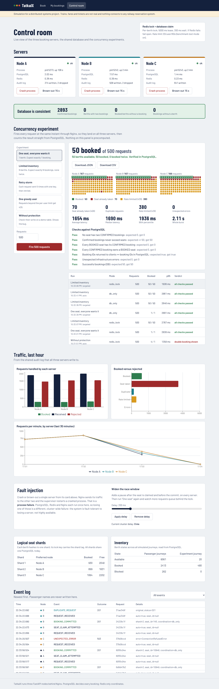
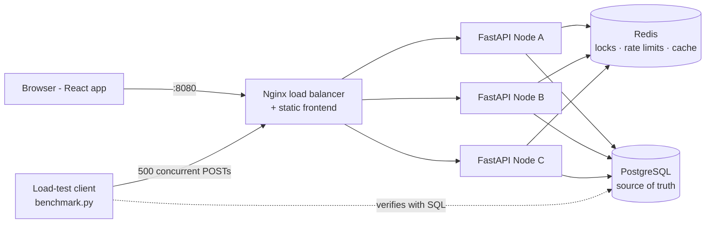
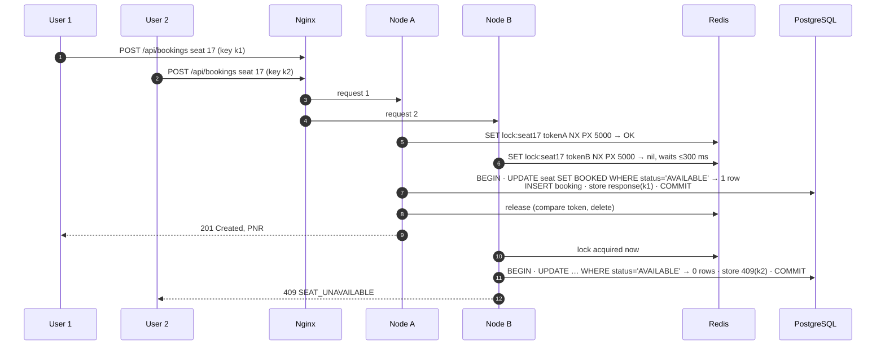

# TatkalX — Distributed Ticket Booking System with Double-Booking Prevention

**At a glance:** 3 stateless FastAPI nodes behind Nginx, PostgreSQL as the source of truth, Redis for locks and rate limits.
**500 concurrent requests for 1 seat → exactly 1 booking** (an unprotected baseline sold it 4 times); 100 bookings each sent 5× with the same idempotency key → exactly 100 bookings.
**480/480 bookings succeeded** while a node crashed, a node browned out and Redis went down. 15/15 pytest tests pass.

> **Simulation.** All trains, schedules, PNRs and bookings are fictional. Nothing connects to any real railway system.

TatkalX simulates the Tatkal rush: hundreds of people pressing *Book* for the same few berths at the same instant.
Three FastAPI servers behind Nginx accept the requests; PostgreSQL decides who gets each berth; Redis coordinates.
A built-in control room fires 500 simultaneous requests and proves — from the database itself — that no berth is ever sold twice.



**Headline results** (full detail in [`docs/RESULTS.md`](docs/RESULTS.md)):
500 requests for 1 berth → **1 booking**; 500 requests for 50 berths → **50 bookings, none twice** (with and without Redis);
100 bookings each sent 5× with the same key → **100 bookings**; a node killed, a node browned out and Redis stopped during
traffic → **480/480 bookings succeeded**; the deliberately unprotected design → **one berth sold 4 times**. `pytest`: **15/15 passed**.

---

## Contents
1. [Project overview](#1-project-overview) · 2. [Problem statement](#2-problem-statement) · 3. [Objectives and scope](#3-objectives-and-scope) · 4. [Architecture](#4-architecture) · 5. [Technology stack](#5-technology-stack) · 6. [Distributed-systems concepts](#6-distributed-systems-concepts) · 7. [Database schema and constraints](#7-database-schema-and-integrity-constraints) · 8. [API](#8-api-documentation) · 9. [Local installation](#9-local-installation-without-docker) · 10. [Docker setup](#10-docker-setup) · 11. [Three backend instances](#11-running-the-three-backend-instances) · 12. [A normal booking](#12-making-a-normal-booking) · 13. [500-request benchmark](#13-running-the-500-request-benchmark) · 14. [Failure injection](#14-injecting-and-recovering-from-failures) · 15. [Invariants](#15-benchmark-invariants-and-how-to-verify-them) · 16. [Limitations](#16-known-limitations) · 17. [Future work](#17-future-enhancements)

Also: [`docs/ARCHITECTURE.md`](docs/ARCHITECTURE.md) (Phase 1 design) · [`docs/VIVA_GUIDE.md`](docs/VIVA_GUIDE.md) · [`docs/RESULTS.md`](docs/RESULTS.md)

---

## 1. Project overview
- **Frontend** (React + TypeScript): search trains, pick a berth on a sleeper-coach seat plan that refreshes every 3 s (green available, amber *held* while another request's lock is in flight, red booked, hatched not for sale), passenger form, PNR ticket, My bookings, and an admin **Control room**.
- **Backend**: three identical FastAPI processes (Node A/B/C) behind Nginx, sharing PostgreSQL and Redis.
- **Proof**: a benchmark harness (500 concurrent requests, 5 scenarios), a failure-injection demo, and a pytest suite — all verifying results directly in PostgreSQL.

## 2. Problem statement
When many clients race for limited inventory, a naive *check availability → write booking* design lets two requests both see "available" and both write — overselling. Retries after a timeout can create a second booking. Multiple servers make in-process locks useless, and traffic spikes overload servers. TatkalX must prevent double booking, overselling and duplicate bookings across several server instances, and keep working when one instance fails.

## 3. Objectives and scope
In scope: correct booking under concurrency across 3 nodes; atomic DB claims + constraints; Redis distributed lock with safe ownership; idempotency; rate limiting; logical sharding; event log; load balancing; health checks; failure injection; reproducible benchmarks; dashboard.
Out of scope (documented, not built): payments, fares, cancellations/waitlist, real authentication, multi-region, replicated database.

## 4. Architecture



Two users booking the same berth at the same moment:



Component roles, single points of failure and folder structure: [`docs/ARCHITECTURE.md`](docs/ARCHITECTURE.md).

## 5. Technology stack
| Layer | Technology (pinned) |
|---|---|
| Frontend | React 19, Vite 8, TypeScript 5.9, Tailwind CSS 4, Axios 1.20, Recharts 3, React Router 7, Barlow fonts (bundled) |
| Backend | Python 3.12, FastAPI 0.143, Uvicorn 0.54 (uvloop/httptools), Pydantic 2.14 |
| Data | PostgreSQL 16, SQLAlchemy 2.1 (asyncio) + asyncpg, Alembic 1.20 |
| Coordination | Redis 7 (redis-py 8.1) |
| Infra | Nginx 1.27 load balancer, Docker Compose |
| Testing | pytest 9 + pytest-asyncio, HTTPX, custom asyncio load generator |

## 6. Distributed-systems concepts
| Concept | Where in the code | What it does here |
|---|---|---|
| Multiple instances | `scripts/cluster.py`, `docker-compose.yml` | Node A/B/C, each with `NODE_ID`; every response has `X-Served-By` and every event records the node |
| Load balancing | `nginx/` | Round robin, passive health checks, failover with `proxy_next_upstream … non_idempotent` (safe because of idempotency keys) |
| Mutual exclusion (authoritative) | `repositories/__init__.py` `SeatRepository.CLAIM_SPECIFIC` | `UPDATE … WHERE status='AVAILABLE'`; exactly one row must change |
| Distributed lock | `distributed/lock.py` | `SET NX PX` + random token, Lua compare-and-delete, bounded wait, explicit `RedisUnavailable` |
| Transactions | `services/booking_service.py` `_transaction` | Seat claim + booking + stored response in one transaction |
| Idempotency | `IdempotencyRepository`, `booking_requests` | Unique `(user_id, idempotency_key)`; replay stored response; 422 on payload mismatch; 409 while in flight; stale takeover with token fencing |
| Rate limiting | `distributed/rate_limiter.py` | Atomic Lua `INCR`+`PEXPIRE`, per user and per IP, HTTP 429 + `Retry-After`; test mode lifts only the per-IP ceiling |
| Sharding (logical) | `distributed/sharding.py` | `crc32(coach-seat) % 3 + 1`; shard id on each seat; `{shard-n}` hash-tagged lock keys; `shard_dsn()` extension point |
| Event log | `monitoring/events.py` | Buffered multi-row inserts of REQUEST_RECEIVED, LOCK_ACQUIRED/FAILED, SEAT_CLAIM_ATTEMPTED, BOOKING_COMMITTED, SEAT_UNAVAILABLE, DUPLICATE_REQUEST, RATE_LIMITED, DEPENDENCY_FAILURE … with node, request id, booking id, outcome. No passenger names |
| Graceful degradation | `REDIS_FAILURE_POLICY=fail_open` | Redis down → DB-only mode, still correct, health `degraded` |
| Fault injection | `distributed/failure.py`, `api/admin.py` | Crash a node (exit 75), brown-out (503s), cluster-wide delay inside the transaction |

**Coordination modes** (`COORDINATION_MODE`): `redis_lock` (default) = Redis per-seat lock + PostgreSQL claim; `db_only` = PostgreSQL claim only. Both give identical correctness; the lock reduces wasted DB work. Redlock is deliberately *not* used — see the viva guide (Q12) for why no lease-based lock can be the sole guard.

## 7. Database schema and integrity constraints
Tables: `trains`, `journeys`, `journey_seats`, `bookings`, `booking_requests` (idempotency ledger), `booking_events` (audit), `benchmark_runs`, plus `naive_demo_seats` / `naive_demo_bookings` (deliberately unprotected, demo only). Migration: `backend/alembic/versions/0001_initial_schema.py`.

| Constraint | Table | Why it matters |
|---|---|---|
| `uq_seat_per_journey (journey_id, coach_number, seat_number)` | journey_seats | Each berth exists once per journey — a stable identifier to contend on |
| `ck_seat_status` | journey_seats | Only AVAILABLE / BOOKED / BLOCKED (HELD is derived live from Redis locks, not stored) |
| `ck_seat_booking_consistency: (status='BOOKED') = (booking_id IS NOT NULL)` | journey_seats | Seat state and owner can never disagree |
| `uq_seat_booking_id`, `fk_seat_booking DEFERRABLE INITIALLY DEFERRED` | journey_seats | A seat row points to at most one booking; the deferred FK lets the claim (row lock) happen before the booking insert in one transaction |
| `uq_one_confirmed_booking_per_seat` partial unique index `WHERE status='CONFIRMED'` | bookings | **Independent last line of defence**: a 2nd confirmed booking for a seat cannot be stored |
| `uq_idempotency_key_per_user (user_id, idempotency_key)` | booking_requests | A retry can never create a second booking; concurrent same-key requests serialise on this index |
| `ck_request_state`, `attempt_token` | booking_requests | PROCESSING → COMPLETED; the completing UPDATE is conditional on the owner's token (fencing) |
| `ck_passenger_age`, `ck_booking_status`, FKs with CASCADE | bookings | Valid data, clean test resets |

Seat status lives **only** in `journey_seats.status`; a booking's own status says whether the *booking* is active.

## 8. API documentation
Interactive docs: **http://localhost:8080/docs** (OpenAPI). Every response includes `X-Served-By` (node) and `X-Request-Id`.

| Method | Path | Notes |
|---|---|---|
| GET | `/api/trains` | Simulated trains (Redis-cached 60 s) |
| GET | `/api/journeys?source=&destination=&date=` | Journeys with live seat counts |
| GET | `/api/journeys/{id}/seats` | Seat map; AVAILABLE seats with an active lock appear as HELD |
| POST | `/api/bookings` | Headers `X-User-Id`, **`Idempotency-Key`** (8–80 chars) |
| GET | `/api/bookings/{booking_id}` | Owner (`X-User-Id`) or admin |
| GET | `/api/users/{user_id}/bookings` | Own history |
| GET | `/api/health` | Node, pid, uptime, DB/Redis latency, injected faults → `ok` / `degraded` (200) / `unhealthy` (503) |
| GET | `/api/metrics?window_minutes=60` | Per-node event counts, outcomes, timeline, inventory, shards, integrity counters, config |
| GET | `/api/admin/booking-events` | Admin token. Filters `event_type`, `node_id`, `journey_id` |
| POST | `/api/admin/benchmark` | Dev + admin. `{scenario, requests, seats, allocation}` → 202 `{run_id}` |
| GET | `/api/admin/benchmark/runs[/{id}[/report?format=json\|csv]]` | Results and downloads |
| POST | `/api/admin/reset-test-data` | Dev + admin. `{scenario, seats}` → fresh TEST journey |
| POST/DELETE | `/api/admin/failure/{crash\|unhealthy\|delay}` | Dev + admin. Reach a specific node via `/node/{a\|b\|c}/api/...` |

Dev endpoints are disabled when `APP_ENV=production` or `ENABLE_DEV_ENDPOINTS=false` (403).

**Book a seat**
```http
POST /api/bookings
X-User-Id: heli-demo
Idempotency-Key: web-6f1c2e0e-1d1b-4c7a-9a4b-0f2b8b1d7a11
Content-Type: application/json

{"journey_id": 23, "seat_id": 4812, "passenger": {"name": "Heli Makwana", "age": 25, "gender": "F"}}
```
`201 Created`
```json
{"booking_id": "91fbebf3-…", "pnr": "1353315371", "status": "CONFIRMED", "journey_id": 23,
 "seat": {"id": 4812, "coach_number": "B1", "seat_number": 2, "berth_type": "MB", "shard_id": 2},
 "passenger_name": "Heli Makwana", "node_id": "B", "coordination": "redis_lock", "simulated": true, "...": "..."}
```
Use `"auto_allocate": true` instead of `seat_id` to get any free berth.

| Status | `error.code` | Meaning |
|---|---|---|
| 409 | `SEAT_UNAVAILABLE` | Berth already booked (the database said no) |
| 409 | `SEAT_BUSY` | Another request holds this berth's lock right now |
| 409 | `SOLD_OUT` | Auto-allocation found no free berth |
| 409 | `REQUEST_IN_PROGRESS` | Same key still being processed — retry shortly (`Retry-After: 1`) |
| 422 | `IDEMPOTENCY_KEY_REUSED` / `VALIDATION_ERROR` / `INVALID_IDEMPOTENCY_KEY` | Bad request |
| 429 | `RATE_LIMITED` | Per-user or per-IP limit; `Retry-After` set |
| 503 | `SERVICE_UNAVAILABLE` | Database unreachable — safe to retry with the same key |

A replayed response carries `Idempotent-Replayed: true`.

## 9. Local installation (without Docker)
Tested on Ubuntu 24.04 with Python 3.12, Node 22, PostgreSQL 16, Redis 7, Nginx. (On Windows, use Docker — §10 — or WSL2 for these steps.)

```bash
# 1. services
sudo apt install postgresql-16 redis-server nginx
sudo -u postgres psql -c "CREATE USER tatkalx WITH PASSWORD 'tatkalx_dev_pw';" \
                     -c "CREATE DATABASE tatkalx OWNER tatkalx;" -c "CREATE DATABASE tatkalx_test OWNER tatkalx;"

# 2. config
cp .env.example .env        # set POSTGRES_PASSWORD/DATABASE_URL password, ADMIN_TOKEN; RATE_LIMIT_TEST_MODE=true for benchmarks

# 3. Python
python3.12 -m venv .venv && . .venv/bin/activate
pip install -r requirements.txt

# 4. frontend build (served by Nginx)
cd frontend && npm ci && npm run build && cd ..

# 5. migrate, seed, start Nginx + 3 nodes (foreground supervisor; Ctrl+C stops the nodes)
scripts/start_local.sh
# open http://localhost:8080        stop everything: scripts/stop_local.sh
```
Frontend hot-reload during development: `cd frontend && npm run dev` → http://localhost:5173 (proxies `/api` to Nginx :8080).

## 10. Docker setup
```bash
cp .env.example .env            # edit passwords and ADMIN_TOKEN
docker compose up --build       # postgres, redis, migrate (one-shot), node-a/b/c, nginx
# open http://localhost:8080
```
PostgreSQL and Redis are on the internal network only (no published ports). On Windows use Docker Desktop and run the same commands in PowerShell.

## 11. Running the three backend instances
- **Docker:** services `node-a`, `node-b`, `node-c` (same image, `NODE_ID` A/B/C, `restart: on-failure`).
- **Local:** `python scripts/cluster.py` starts A/B/C on 127.0.0.1:8001–8003 and restarts a crashed node after 8 s. Logs: `runtime/logs/node-{A,B,C}.log`.
- Check distribution: `for i in 1 2 3 4 5 6; do curl -sI localhost:8080/api/health | grep -i x-served-by; done` → A, B, C, A, B, C.
- Per-node health: `curl localhost:8080/node/a/api/health`.

## 12. Making a normal booking
Open http://localhost:8080 → pick a train under *Leaving today* → choose a coach and a green berth → enter passenger details → **Book this berth** → PNR ticket showing which node committed it. *My bookings* lists your tickets (demo identity stored in the browser). Try opening the same train in two windows and booking the same berth.

## 13. Running the 500-request benchmark
**From the dashboard:** Control room → enter the `ADMIN_TOKEN` → choose an experiment → **Fire 500 requests**. Results (request grid by node, counts, latency, PostgreSQL checks, JSON/CSV download) appear in seconds.

**From the command line** (needs `RATE_LIMIT_TEST_MODE=true` on the nodes):
```bash
set -a; . ./.env; set +a
python load_testing/benchmark.py --scenario one_seat --requests 500
python load_testing/benchmark.py --scenario limited --seats 50 --allocation targeted   # or --allocation auto
python load_testing/benchmark.py --suite                 # all scenarios incl. idempotency, rate_limit, naive_race
# Docker:
docker compose --profile bench run --rm bench           # runs --suite inside the network
```
Reports: `load_testing/reports/<run_id>.json` (summary + every request) and `.csv`. Compare modes by restarting the nodes with `COORDINATION_MODE=db_only`.

## 14. Injecting and recovering from failures
| Failure | How | Expected |
|---|---|---|
| Kill Node A (process failure) | Control room → Node A → **Crash process**, or `curl -X POST -H "X-Admin-Token: $ADMIN_TOKEN" localhost:8080/node/a/api/admin/failure/crash`, or `docker compose kill node-a` | A shows *down*; traffic goes to B, C; restarted automatically with a new pid |
| Operator stop/start | `python scripts/node_ctl.py stop A` / `start A` (local) · `docker compose stop node-a` / `start node-a` | Same, but stays down until started |
| Brown-out | **Brown-out 15 s** (node answers 503) | Nginx fails over on 503 |
| Widen the race window | Fault injection → delay 300 ms → rerun a benchmark | More lock contention, same correct counts |
| Redis outage | `redis-cli shutdown nosave` / `docker compose stop redis` | Health `degraded`; bookings continue DB-only; recovers when Redis returns |
| Database outage | stop PostgreSQL / `docker compose stop postgres` | Bookings 503 (retryable), health `unhealthy` — a *cluster-wide* failure, unlike a node failure |

Automated version: `python load_testing/failure_demo.py --duration 32 --rate 15` (crash A at 4 s, brown-out B at 16 s, stop Redis at 22 s; Docker: run it in the bench container with `--skip-redis` and stop Redis by hand).

## 15. Benchmark invariants and how to verify them
The benchmark checks these automatically; to check by hand:
```sql
-- no seat with two confirmed bookings (must be 0 rows)
SELECT journey_seat_id, count(*) FROM bookings WHERE status='CONFIRMED' GROUP BY 1 HAVING count(*) > 1;
-- bookings never exceed seats, per journey
SELECT j.id, count(b.*) AS booked, count(DISTINCT s.id) AS seats FROM journeys j
  JOIN journey_seats s ON s.journey_id=j.id LEFT JOIN bookings b ON b.journey_seat_id=s.id AND b.status='CONFIRMED' GROUP BY j.id;
-- seat <-> booking cross-reference (both must be 0)
SELECT count(*) FROM journey_seats s WHERE s.status='BOOKED' AND NOT EXISTS
  (SELECT 1 FROM bookings b WHERE b.id=s.booking_id AND b.journey_seat_id=s.id AND b.status='CONFIRMED');
SELECT count(*) FROM bookings b WHERE b.status='CONFIRMED' AND NOT EXISTS
  (SELECT 1 FROM journey_seats s WHERE s.id=b.journey_seat_id AND s.booking_id=b.id AND s.status='BOOKED');
-- one booking per idempotency key
SELECT user_id, idempotency_key, count(*) FROM booking_requests GROUP BY 1,2 HAVING count(*) > 1;
```
The Control room's green "Database is consistent" strip runs the first and third/fourth queries live.

Tests: `cd backend && pytest` (uses database `tatkalx_test`; override with `TEST_DATABASE_URL`, `TEST_REDIS_URL`).

## 16. Known limitations
- **Not highly available:** Nginx, PostgreSQL and Redis are single instances; only the API tier is replicated.
- Sharding is logical; all shards share one database.
- Lease-based Redis locks can be violated by long pauses — correctness relies on PostgreSQL, not the lock.
- Audit events are buffered (≤250 ms) and can be lost on a crash; bookings cannot.
- Fixed-window rate limiter; demo authentication (`X-User-Id`, `X-Admin-Token` in localStorage) — production needs OAuth2/OIDC with signed tokens, server-side sessions and MFA for admins.
- Docker Compose file was validated (`docker compose config`) but the containers were not started in the build environment (Docker Hub unreachable); the identical topology was run natively.
- Reported latencies come from a 2-vCPU VM shared by every component and the load generator.

## 17. Future enhancements
PostgreSQL HA (Patroni + synchronous replica, PgBouncer) and real per-shard databases; Redis Sentinel/Cluster with fencing tokens on seat rows; redundant load balancers; Kubernetes with readiness probes and autoscaling; a virtual waiting room at Tatkal opening; time-limited seat holds with payment via saga/outbox; cancellations and waitlist; token-bucket rate limits and bot protection; OpenTelemetry tracing and Prometheus/Grafana; Locust runs on production-like hardware.
