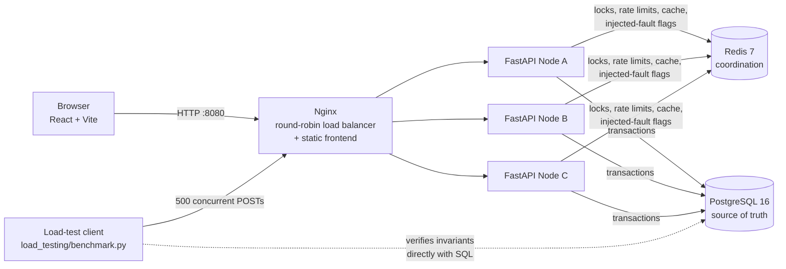

# TatkalX — Architecture (Phase 1)

## 1. Components and their roles



| Component | Role | Holds authoritative state? |
|---|---|---|
| React frontend | Search, seat map, booking form, confirmation, My bookings, Control room (admin) | No |
| Nginx | Round-robin load balancing across A/B/C, passive health checks (`max_fails=1 fail_timeout=5s`), failover retries (`proxy_next_upstream … non_idempotent`), serves the built frontend | No |
| FastAPI nodes A, B, C | Stateless booking API. Each has its own process, connection pools and `NODE_ID`; every response carries `X-Served-By` | No |
| Redis | Per-seat distributed lock (advisory), fixed-window rate limiter, read cache for train lists, cluster-wide fault-injection flag, benchmark mutex | No — losing it never loses a booking |
| PostgreSQL | Seats, bookings, idempotency ledger, audit events, benchmark results. **Decides every booking.** | **Yes** |
| Supervisor (`scripts/cluster.py`) / Docker `restart: on-failure` | Restarts a crashed node | No |

## 2. The double-booking prevention strategy (most reliable first)

TatkalX uses **defence in depth**. Each layer is independent; the lower layers are the ones correctness relies on.

1. **Atomic conditional UPDATE (authoritative).**
   ```sql
   UPDATE journey_seats
      SET status = 'BOOKED', booking_id = :booking_id, version = version + 1, updated_at = now()
    WHERE id = :seat_id AND journey_id = :journey_id AND status = 'AVAILABLE'
   RETURNING id, coach_number, seat_number, berth_type, shard_id;
   ```
   The check (`status = 'AVAILABLE'`) and the write happen in one statement. Under READ COMMITTED, a second
   transaction that tries to update the same row **blocks on the row lock**, and when the first commits,
   PostgreSQL **re-evaluates the WHERE clause against the committed row** — it now matches 0 rows. The
   application treats anything other than exactly 1 returned row as "seat unavailable".
2. **Same transaction for seat + booking + stored response.** The seat claim, the `bookings` insert and the
   idempotency record's final response commit together. If anything fails, all three roll back — a seat is never
   left BOOKED without its booking, and a booking is never visible before its seat is claimed.
3. **Partial unique index** `uq_one_confirmed_booking_per_seat ON bookings(journey_seat_id) WHERE status='CONFIRMED'`.
   Even if a bug bypassed step 1, PostgreSQL would refuse a second CONFIRMED booking for the same seat (covered by a test).
4. **CHECK constraint** `(status = 'BOOKED') = (booking_id IS NOT NULL)` keeps a seat's state and its owner in sync.
5. **Idempotency ledger** (`booking_requests`, unique `(user_id, idempotency_key)`) — a retried request returns the
   stored result instead of booking again.
6. **Redis lock (optimisation, optional).** `SET key token NX PX ttl`, Lua compare-and-delete release, bounded wait.
   It stops most losing requests before they touch the database, but it is *not* trusted for correctness
   (lease expiry, process pauses, async replication). Run with `COORDINATION_MODE=db_only` and the results are identical.

For automatic allocation ("any free berth") the claim uses
`… WHERE id = (SELECT id … WHERE status='AVAILABLE' ORDER BY … FOR UPDATE SKIP LOCKED LIMIT 1) AND status='AVAILABLE'`,
so concurrent requests take *different* free seats instead of queueing on one.

## 3. Booking request lifecycle

```mermaid
sequenceDiagram
    autonumber
    participant U1 as Passenger 1
    participant U2 as Passenger 2
    participant LB as Nginx
    participant A as Node A
    participant B as Node B
    participant R as Redis
    participant DB as PostgreSQL
    U1->>LB: POST /api/bookings (seat 17, Idempotency-Key k1)
    U2->>LB: POST /api/bookings (seat 17, Idempotency-Key k2)
    LB->>A: request 1 (round robin)
    LB->>B: request 2
    A->>R: rate limit + SET lock:seat17 tokenA NX PX 5000
    R-->>A: OK (lock granted)
    B->>R: rate limit + SET lock:seat17 tokenB NX PX 5000
    R-->>B: nil (held) — retry for up to 300 ms
    A->>DB: INSERT booking_requests k1 (PROCESSING) — commit
    A->>DB: BEGIN; UPDATE seat … WHERE status='AVAILABLE' → 1 row
    A->>DB: INSERT booking; UPDATE booking_requests k1 → COMPLETED; COMMIT
    A->>R: EVAL compare-and-delete(lock, tokenA)
    A-->>U1: 201 Created (PNR, served by A)
    B->>R: SET lock … NX → OK (lock now free)
    B->>DB: BEGIN; UPDATE seat … WHERE status='AVAILABLE' → 0 rows
    B->>DB: store 409 for k2; COMMIT
    B->>R: release lock (own token only)
    B-->>U2: 409 SEAT_UNAVAILABLE
    Note over A,DB: If Redis were down, both go straight to the UPDATE;<br/>PostgreSQL still lets exactly one win.
```

## 4. Single points of failure and limitations (stated honestly)

| Component | Replicated here? | What happens if it fails |
|---|---|---|
| FastAPI nodes | **Yes (3)** | Nginx routes around it; in-flight POSTs are retried on another node (safe thanks to idempotency keys). Demonstrated. |
| Nginx | No | All client traffic stops. Production: 2+ load balancers with a floating IP / DNS or a cloud LB. |
| PostgreSQL | No | Bookings return `503 SERVICE_UNAVAILABLE` (safe to retry with the same key); reads fail; health reports `unhealthy`. Production: primary + synchronous standby with automatic failover (Patroni), PgBouncer. |
| Redis | No | Nodes switch to DB-only mode (`fail_open`): bookings stay correct, locks/rate limits/cache are skipped, health reports `degraded`. Demonstrated. |

So the system is **fault tolerant to the loss of a backend process**, but it is **not highly available**:
the load balancer, the database and Redis are each single instances.

Other limitations:
- One PostgreSQL database holds all three logical shards; sharding is simulated (shard id on each seat, shard-tagged lock keys, a `shard_dsn()` extension point).
- The audit log is written asynchronously (≤250 ms buffer) — a crash can lose a few *audit events*, never bookings.
- Demo authentication (`X-User-Id`, `X-Admin-Token`) is not production authentication.
- Fixed-window rate limiting allows bursts at window boundaries.

## 5. Folder structure

```
tatkalx/
  backend/
    app/
      api/            public.py (REST), admin.py (admin + dev-only)
      core/           config, db engine, redis client, errors, demo auth, logging
      models/         SQLAlchemy models
      schemas/        Pydantic V2 request/response models
      repositories/   all SQL (parameterised): seats, journeys, bookings, idempotency
      services/       booking_service (the workflow), seed_service, metrics_service
      distributed/    lock.py, rate_limiter.py, sharding.py, failure.py
      monitoring/     buffered event recorder, node state
      main.py         app factory, middleware (X-Served-By, brown-out), error handlers
    alembic/          migration 0001 with every constraint
    tests/            pytest suite (real PostgreSQL + Redis)
  frontend/           React + Vite + TypeScript + Tailwind + Axios + Recharts
  load_testing/       benchmark.py (500-request scenarios), failure_demo.py, reports/
  nginx/              nginx.conf (Docker), nginx.local.conf (no Docker), shared proxy include
  scripts/            seed_data.py, reset_test_data.py, cluster.py (supervisor), node_ctl.py, start/stop
  docs/               this file, RESULTS.md, VIVA_GUIDE.md, screenshots/
  docker-compose.yml  .env.example  requirements.txt  README.md
```
